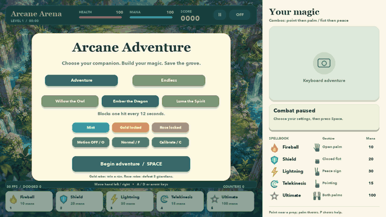

# Arcane Adventure — The Enchanted Grove



A local webcam-controlled spellcasting adventure. The existing trained five-gesture
model controls spells; mirrored palm position controls movement and interactive props.
The camera/model runs in a separate helper process to avoid the macOS OpenCV/Pygame
native-library conflict. No new gesture dataset or model training is required.

## Run

Close any older game window first. The folder name has a trailing space:

```bash
cd "$HOME/Desktop/Hand Gesture Game "
./.venv/bin/python arcane_adventure.py
```

Or double-click **Play Adventure Edition.command**.

The window title is **Arcane Adventure - The Enchanted Grove**. At camp choose Adventure
or Endless, a companion, an unlocked robe, optional motion spells (O), difficulty (F)
and hand calibration (C). Press Space to begin.

```bash
./.venv/bin/python arcane_adventure.py --no-camera
./.venv/bin/python arcane_adventure.py --boss-practice
./.venv/bin/python arcane_adventure.py --mode endless --companion dragon
./.venv/bin/python arcane_adventure.py --motion
```

Other options: `--camera 1`, `--mute`, `--seed 42`, `--max-frames N`,
`--difficulty easy|normal|hard`.
Use the existing `.venv/bin/python` rather than Anaconda base. Required model files are
`models/gesture_model.pth`, its matching JSON metadata, and `models/hand_landmarker.task`.
Artwork remains bundled locally in `assets/images`; provenance is in `assets/images/ART.md`.

## Project layout

| File | Role |
|---|---|
| `arcane_adventure.py` | The game: encounters, upgrades, props, camp/end screens, CLI entry point |
| `spell_engine.py` | Shared engine: combat rules, camera worker, sound, base HUD |
| `game_camera.py` | Camera helper process (OpenCV + MediaPipe + classifier) |
| `frame_protocol.py` | Binary frame format between the helper and the game |
| `motion_controls.py` | Optional geometry-based motion spells |
| `collect_data.py` / `train_model.py` / `inference.py` | Data collection, training, live recognizer |
| `tests/` | pytest suite (headless) |
| `tools/make_demo_gif.py` | Regenerates `docs/demo.gif` |

## Setup

```bash
python3.13 -m venv .venv
.venv/bin/python -m pip install -r requirements.txt
```

`requirements.txt` pins the exact tested versions. `pyproject.toml` lists the direct
dependencies, with optional `train` and `dev` groups.

## Difficulty, calibration and top scores

- **Difficulty** (F at camp, or `--difficulty`): Easy takes 60% damage, enemies move at
  85% speed and spawn 30% less often. Hard takes 140% damage, enemies move at 115% speed
  and spawn 20% more often. Normal is the original balance. The choice is saved.
- **Calibration** (C at camp, camera required): hold an open palm and sweep from your
  comfortable far left to far right for 4 seconds. Your range then spans the whole
  arena, so you need not reach the edge of the camera view. Recalibrate any time; a sweep
  that covers less than 20% of the view is rejected.
- **Top scores**: the five best finished runs (score, difficulty, mode) are saved and the
  top three appear on the end screen, with a "New high score!" message for a new record.

## Controls

| Gesture | Key | Spell | Mana |
|---|---|---|---:|
| One open palm | 1 | Fireball / throw a lifted prop | 10 |
| Closed fist | 2 | Shield / seal a nearby portal | 20 |
| Peace sign | 3 | Lightning | 30 |
| Pointing | 4 | Telekinesis / lift a prop near the cursor | 15 |
| Both palms open | 5 | Ultimate | 100 |

Move your hand left/right to steer. A/D or arrow keys also move. Palm fires repeatedly;
other spells require switching poses or lowering your hands to rearm. The feedback card
shows the recognized spell, confidence, cooldown or missing mana. Mana regenerates at
10/sec, and defeats/counters/dodges give additional mana. P pauses/resumes, M mutes,
R restarts after victory/game over, Esc/Q exits.

Combos: point -> palm gives Meteor Burst; fist -> peace gives Storm Counter. Complete the
sequence within 3 seconds (4 with Luma). Successful combos consume each spell's normal
cost. A freshly cast shield reflects shots during its first 0.65 seconds (gold rim);
the remaining part of its 2-second duration blocks shots. Enemy aiming lines warn for
0.85 seconds. Orb damage is 12 HP; contact damage is 20 HP, with 0.65-second damage grace.

## Adventure and upgrades

The five encounters are Forest Entrance, Swarm Hollow, Protect the Heart Tree,
Seal the Portals, and Grove Guardian. Clear remaining spirits after each wave. Protect
the tree for 35 seconds; enemies reaching it damage the tree. During the portal encounter,
stand beneath each portal and cast Shield: 0.9 seconds of shield presence seals it.
There are three portals. Completing the final guardian encounter wins the adventure.

Each of the first four encounters offers three random, unique upgrade choices:

- Twin Flame: two weaker fireballs.
- Mirror Shield: counters reflect three shots.
- Thunder Chain: lightning reaches two additional distinct enemies.
- Gravity Well: telekinesis groups enemies toward the middle of the arena.
- Vital Bloom: restore 30 health immediately and 5 after each later encounter.
- Mana Spring: +5 mana/sec while standing still.

Combat pauses during selection. Hand position highlights a card; hold the selection
steady for at least 0.6 seconds, then make a fist to confirm. Release/switch the entry pose
first to prevent accidental selection. Clicking a card or pressing 1–3 also selects it;
arrow keys highlight and Space confirms. Upgrades reset between runs.

Endless mode keeps spawning encounters and offers upgrades after guardian defeats.

## Tactical enemies and guardian phases

Swarm spirits arrive in small, fast groups. Gold-marked archers fire aimed orbs.
Armored golems block ordinary fireballs until telekinesis exposes them for 4 seconds;
lightning, counters and thrown props can also damage them. Healers restore nearby
surviving enemies every 3 seconds. Different shapes and symbols identify these roles.

The guardian has three phases:

1. Crystal: destroy its two stationary purple crystals before damaging the guardian.
2. Mirror: reflect a pink shot into it to open a 4-second attack window. Reflections
   prioritize the mirror guardian and lead its movement.
3. Storm: below half health, wider volleys and periodic storms mark a green safe lane.
   Move into the lane before the 2-second warning ends, or block the strike with Shield.

Adventure ends at victory. Endless spawns another stronger guardian 60 seconds after
its defeat. Boss practice skips to the final encounter and starts it after 5 seconds.

## Interactive props

A pale cursor follows your hand in the arena. Point with the cursor near a rock, seed or
cyan crystal to lift it. Moving your hand then drags the prop while the wizard stays
still. Open your palm to launch it toward a target. Lower your hand to place it as cover.
A stationary rock intercepts hostile shots. Seeds explode over a larger area; crystals
have smaller splash. A point -> palm combo charges the thrown prop into a Meteor attack.
When all props have been used, a fresh set appears after 8 seconds.

Keyboard: 4 lifts a nearby prop; arrows reposition it; 1 throws. In keyboard mode the
initial nearest prop is the central seed. Hand-tracking loss places hand-held props;
keyboard-held props remain available during camera failures. P pauses without dropping
held props.

## Companions, cosmetics and motion

Willow the Owl attracts mana drops. Ember the Dragon blocks one hit every 12 seconds.
Luma the Spirit marks healers/archers for +1 damage and extends combos to 4 seconds.
Choose the companion at camp. Robes: Mint is available immediately, Gold unlocks after
an adventure victory, Rose after 3 guardian defeats. Unlocks and best score persist in
`reports/adventure_profile.json`; they survive app restarts. Run metrics are saved in
`reports/game_last_run.json`.

Motion spells are **off by default**. Enable at camp or while paused with O:

| Movement | Effect | Mana | Keyboard |
|---|---|---:|---|
| Sweep an open palm sideways | Wind Slash damages/pushes nearby enemies and clears low shots | 15 | Z |
| Draw a circle while holding a peace sign | Stationary Rune Ward blocks shots for 3 seconds | 20 | X |
| Hold a steady fist for 1.3 seconds | Charged Ward extends shield and dispels close shots | 10 | V |

Motion spells have a 3-second cooldown and are disabled while dragging props. Recognition
uses normalized palm trajectories, confidence gating, single-hand checks and release/reset
logic. This is an optional geometry-based recognizer, not a retrained gesture model.
Small movements and two-hand input do not trigger it. Camera frame gaps reset trajectories.
Live tracking sensitivity and physical gesture timing need a play-through on your laptop.

## Checks

See `TEST_NEW_GAME.md` for the user play-through checklist. Automated checks run
headless (no window, audio or webcam):

```bash
./.venv/bin/python -m pytest
./.venv/bin/python -m ruff check .
```

GitHub Actions (`.github/workflows/tests.yml`) runs both on every push once the project
is pushed to GitHub.

Checks cover route progression/victory, real reflected-shot collision, upgrade effects,
menu isolation, enemy tactics, objectives, boss phases, object controls, companions,
motion trajectories and negative cases, saved unlocks, all screens, real-model
synthetic-camera transport, the binary frame protocol, idle-class handling, difficulty,
calibration and the score board. The full-route stress run restores player health to isolate
progression; it is not evidence that difficulty is balanced. Physical gestures, actual
webcam conditions, audio playback and gameplay balance still need manual testing.

If the camera fails, close competing camera apps and allow camera access for Terminal in
macOS Privacy & Security. Keyboard/mouse controls remain available.

The bundled model has five classes and no idle class, so unrelated visible poses
(scratching your face, reaching for the keyboard) may be read as spells. To fix this,
double-click **Collect Idle Gesture.command** and record about 200 relaxed or random
hand positions, then retrain (see `TRAINING.md`). The game already treats the idle
class as "no spell".
